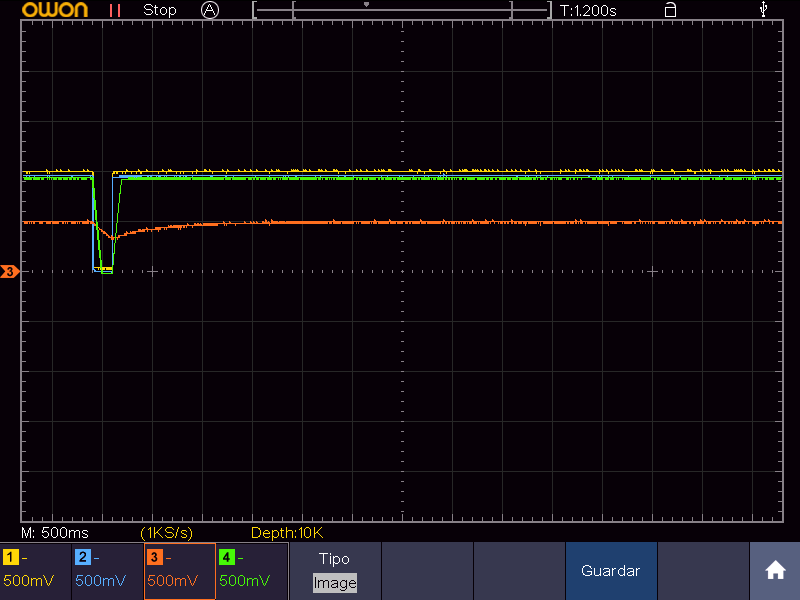
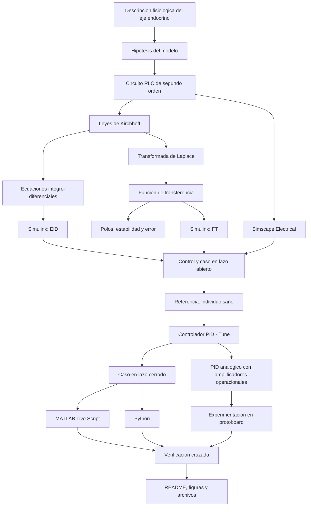

[](https://matlab.mathworks.com/open/github/v1?repo=l23212239/MSFP4)
 # Práctica 4 — Modelado y control del sistema endócrino

Repositorio académico de la asignatura **Modelado de Sistemas Fisiológicos**, correspondiente al programa de **Ingeniería Biomédica** del Tecnológico Nacional de México / Instituto Tecnológico de Tijuana. Esta práctica (sección 5.6 del manual) integra interpretación fisiológica, analogía eléctrica, formulación matemática, análisis temporal y de estabilidad, control clásico PID, verificación computacional y diseño de un controlador analógico.

El caso de estudio representa de manera fenomenológica un eje hormonal mediante un circuito eléctrico **RLC de segundo orden**: un estímulo inicia la secreción, la hormona se transporta, se almacena temporalmente en un compartimento y produce una respuesta retardada en el tejido diana antes de ser utilizada o eliminada. Se compara la respuesta de un individuo sano (**control**) con una condición alterada (**caso**) y se utiliza la respuesta sana como referencia para un controlador PID en lazo cerrado.

**Docente:** Dr. Paul Antonio Valle Trujillo  
**Correo:** paul.valle@tectijuana.edu.mx  
**Departamento:** Ingeniería Eléctrica y Electrónica  
**Institución:** Tecnológico Nacional de México / Instituto Tecnológico de Tijuana  
**Asignatura:** Modelado de Sistemas Fisiológicos  
**Programa:** Ingeniería Biomédica  
**Estudiante:** Gabriel Fernando Trejo Paz · 23212239 · L23212239@tijuana.tecnm.mx

**Repositorio de la práctica:** https://github.com/l23212239/MSFP4  
**Sede:** Blvd. Alberto Limón Padilla s/n, Tijuana, C. P. 22454, B. C., México.

---

<a id="contenido"></a>
## Contenido

1. [Resumen](#resumen)
2. [Competencia y objetivos](#objetivos)
3. [Relación con el temario](#temario)
4. [Interpretación fisiológica y analogía eléctrica](#analogia)
5. [Diagrama biológico](#biologico)
6. [Formulación matemática](#modelo)
7. [Análisis temporal, error y estabilidad](#analisis)
8. [Entrada y condiciones de simulación](#senales)
9. [Implementación en MATLAB, Simulink y Simscape](#matlab)
10. [Control en lazo cerrado y sintonización PID](#pid)
11. [Diseño del controlador analógico](#analogico)
12. [Reproducción en Python](#python)
13. [Resultados y verificación cruzada](#resultados)
14. [Implementación experimental](#experimental)
15. [Flujo de trabajo](#flujo)
16. [Actividades de la práctica](#actividades)
17. [Estructura del repositorio](#estructura)
18. [Requisitos](#requisitos)
19. [Reproducibilidad y entregables](#reproducibilidad)
20. [Referencias](#referencias)
21. [Cómo citar](#citar)

---

<a id="resumen"></a>
## Resumen

La práctica tiene como propósito desarrollar un procedimiento completo de **modelado, análisis, simulación y control** de un sistema endócrino simplificado. A partir de una descripción funcional de los procesos de secreción, transporte, almacenamiento, respuesta y eliminación hormonal se propone un circuito eléctrico equivalente formado por una fuente $V_e(t)$, un resistor $R_1$, un capacitor $C$ y una rama serie $L$–$R_2$. Al contener dos elementos independientes de almacenamiento de energía ($C$ y $L$), el modelo es de **segundo orden**.

Se estudian dos configuraciones con los mismos valores de $R_1$ y $L$, pero con diferente capacitancia y resistencia de eliminación. El control utiliza $C=1\,\mu\mathrm{F}$ y $R_2=100\,\mathrm{k}\Omega$, mientras que el caso utiliza $C=1000\,\mu\mathrm{F}$ y $R_2=1\,\mathrm{k}\Omega$. El caso presenta una respuesta aproximadamente 500 veces más lenta y alcanza solamente el 50 % del nivel hormonal efectivo, interpretado como un **déficit hormonal efectivo (hipofunción)**.

Los modelos se implementan mediante ecuaciones integro-diferenciales, funciones de transferencia y circuitos de Simscape Electrical. Posteriormente se construye un sistema de retroalimentación en el que la respuesta del control funciona como referencia para el caso. La herramienta *Tune* del bloque `PID Controller` entrega un controlador **PID** que se reproduce en Python mediante `python-control` y se traduce a componentes de una realización analógica con amplificadores operacionales.

**Palabras clave:** sistema endócrino; secreción hormonal; circuito RLC; analogía eléctrica; función de transferencia; controlador PID; MATLAB; Simulink; Simscape Electrical; Python; simulación *in silico*.

[Volver al contenido](#contenido)

---

<a id="objetivos"></a>
## Competencia y objetivos

### Competencia a desarrollar

Modelizar sistemas fisiológicos mediante analogías eléctricas, ecuaciones diferenciales y funciones de transferencia para analizar su comportamiento dinámico, y diseñar estrategias de control mediante técnicas de control clásico, contrastando los resultados obtenidos mediante modelado analítico, simulación computacional y experimentación en el Laboratorio de Electrónica.

### Objetivo general

Proponer un circuito eléctrico equivalente de segundo orden para un eje endócrino simplificado, comparar las respuestas de una condición de referencia (control) y una condición alterada (caso), y diseñar un controlador PID que reduzca la diferencia entre ambas respuestas.

### Objetivos específicos

- Interpretar la descripción fisiológica y determinar la topología del circuito equivalente.
- Identificar $V_e(t)$, $V_s(t)$, $F_e(t)$, $F_s(t)$, $R_1$, $C$, $L$, $R_2$, los nodos principales y la referencia eléctrica.
- Obtener $G_{control}(s)$ y $G_{caso}(s)$ mediante la transformada de Laplace.
- Calcular la respuesta final, el error en estado estacionario y los polos de ambas condiciones.
- Formular las ecuaciones integro-diferenciales mediante las leyes de Kirchhoff.
- Implementar ecuaciones, funciones de transferencia y circuitos en Simulink y Simscape Electrical.
- Sintonizar un controlador PID con la herramienta *Tune* y analizar la respuesta en lazo cerrado.
- Reproducir el análisis mediante MATLAB y Python.
- Calcular los componentes del controlador PID analógico con amplificadores operacionales.
- Contrastar simulación y experimentación en protoboard.
- Documentar el desarrollo en un repositorio de GitHub.

[Volver al contenido](#contenido)

---

<a id="temario"></a>
## Relación con el temario

La práctica integra contenidos de las tres unidades de **Modelado de Sistemas Fisiológicos (IBF-1020)**:

| Unidad | Tema oficial | Subtemas relacionados | Aplicación en la práctica |
|---|---|---|---|
| I | Sistemas de control retroalimentados | Función de transferencia, diagramas de bloques, respuesta transitoria, análisis de error y estabilidad | Obtención de las funciones de transferencia, análisis de polos, error estacionario y comparación de las respuestas en lazo abierto y cerrado |
| II | Modelado matemático | Sistema endócrino | Representación fenomenológica de la secreción, transporte, almacenamiento y respuesta hormonal mediante un circuito RLC de segundo orden |
| III | Controladores | Tipos, diseño y métodos de ajuste de controladores; ejemplos aplicados a sistemas fisiológicos | Sintonización del controlador PID y cálculo de su realización analógica con amplificadores operacionales |

El desarrollo combina **Ingeniería de Control, modelado matemático, Electrónica Analógica, Ciencias de la Computación y Fisiología**, en concordancia con las competencias establecidas para la asignatura.

[Volver al contenido](#contenido)

---

<a id="analogia"></a>
## Interpretación fisiológica y analogía eléctrica

El modelo se construye a partir de las siguientes hipótesis del instructivo:

1. Un estímulo fisiológico (neural, metabólico u homeostático) inicia la secreción hormonal → fuente $V_e(t)$.
2. La hormona se transporta desde la glándula hasta el compartimento de interés con retrasos, pérdidas o mecanismos de eliminación → resistencia $R_1$.
3. Parte de la señal hormonal se acumula temporalmente antes de ser utilizada o eliminada → capacitancia $C$.
4. La respuesta del tejido diana no es instantánea; su retardo e inercia se representan mediante la rama serie $L$–$R_2$.
5. El flujo de secreción y transporte es $F_e(t)$ y el flujo asociado con la respuesta del órgano diana es $F_s(t)$.
6. $V_s(t)$ representa el nivel efectivo y normalizado de la señal hormonal disponible.

### Topología del circuito

La rama principal está formada por la fuente $V_e(t)$ y el resistor $R_1$. En el nodo posterior a $R_1$ (nodo de salida) se conecta un capacitor $C$ a la referencia, en paralelo con la rama serie $L$–$R_2$. La salida $V_s(t)$ se mide en el nodo de unión entre $R_1$, $C$ y $L$.

| Nodo | Ubicación | Variable |
|---|---|---|
| Nodo 1 | Terminal positiva de la fuente, antes de $R_1$ | $V_e(t)$ |
| Nodo 2 | Unión de $R_1$, $C$ y $L$ | $V_s(t)$ |
| Nodo 3 | Unión entre $L$ y $R_2$ | — |
| Nodo 0 | Referencia eléctrica (tierra) | $0\,\mathrm{V}$ |

### Correspondencias fisiológico-eléctricas

| Variable o proceso fisiológico | Representación eléctrica | Interpretación dentro del modelo |
|---|---|---|
| Estímulo para la secreción hormonal | $V_e(t)$ | Señal de entrada que activa la respuesta del sistema endócrino |
| Flujo de secreción y transporte hormonal | $F_e(t)$ | Corriente asociada con la transferencia de la señal hormonal hacia el compartimento de respuesta |
| Pérdidas y oposición durante el transporte | $R_1$ | Procesos que reducen o retardan la transmisión de la señal hormonal |
| Acumulación temporal de hormona | $C$ | Capacidad del compartimento para almacenar temporalmente la señal hormonal |
| Retardo o inercia de la respuesta del tejido diana | $L$ | Resistencia dinámica del sistema a cambios rápidos en la respuesta hormonal |
| Utilización, disipación o eliminación de la señal | $R_2$ | Oposición efectiva asociada con la utilización o desaparición de la señal hormonal |
| Flujo asociado con la respuesta del tejido diana | $F_s(t)$ | Corriente de la rama que representa la respuesta del órgano diana |
| Nivel hormonal efectivo | $V_s(t)$ | Señal hormonal normalizada disponible en el compartimento de interés |

### Parámetros del control y del caso

| Componente | Control | Caso | Valor empleado en `sistema.slx` y Python |
|---|---:|---:|---|
| $R_1$ | $1\,\mathrm{k}\Omega$ | $1\,\mathrm{k}\Omega$ | Igual al instructivo |
| $L$ | $100\,\mathrm{mH}$ | $100\,\mathrm{mH}$ | $680\,\mu\mathrm{H}$ en ambas condiciones |
| $C$ | $1\,\mu\mathrm{F}$ | $1000\,\mu\mathrm{F}$ | Igual al instructivo |
| $R_2$ | $100\,\mathrm{k}\Omega$ | $1\,\mathrm{k}\Omega$ | Igual al instructivo |

> **Nota de implementación.** Las simulaciones aportadas utilizan $L=680\,\mu\mathrm{H}$ en lugar de los $100\,\mathrm{mH}$ del instructivo. Como se muestra en la sección de [análisis](#analisis), este cambio únicamente desplaza el polo rápido; el polo dominante, la ganancia DC y, por lo tanto, la forma de las respuestas en $t\in[0,10]\,\mathrm{s}$ permanecen prácticamente iguales. El valor de $L$ empleado en el montaje experimental debe reportarse explícitamente.

La modificación simultánea de $C$ (mayor almacenamiento) y $R_2$ (eliminación acelerada) produce una dinámica diferente entre ambas condiciones. Las correspondencias constituyen una analogía fenomenológica con fines académicos: las unidades y valores de los componentes no representan directamente magnitudes fisiológicas del sistema endócrino.

[Volver al contenido](#contenido)

---

<a id="biologico"></a>
## Diagrama biológico

El diagrama presenta de forma conjunta el **circuito eléctrico equivalente** (izquierda) y el **diagrama biológico del sistema endócrino** como modelo fenomenológico simplificado (derecha), para facilitar la identificación de las correspondencias entre ambos sistemas. En la parte inferior se resume la interpretación de cada elemento pasivo.


### Circuito eléctrico equivalente

- **Entrada:** $V_e(t)$, aplicada entre la terminal de entrada y el nodo de referencia $V_0$ (tierra).
- **Rama principal:** $R_1$, recorrida por el flujo de entrada $F_e(t)$.
- **Nodo de salida:** $V_s(t)$, en la unión de $R_1$, $C$ y $L$.
- **Almacenamiento:** $C$, conectado entre el nodo de salida y la referencia.
- **Rama de respuesta:** $L$ en serie con $R_2$, recorrida por el flujo de salida $F_s(t)$.
- **Referencia eléctrica:** $V_0$, nodo común de retorno de la fuente, de $C$ y de $R_2$.

### Recorrido biológico

El diagrama biológico sigue la secuencia de la señal hormonal, de izquierda a derecha:

| Etapa en el diagrama | Estructura representada | Elemento del modelo | Interpretación |
|---|---|---|---|
| Estímulo fisiológico | Encéfalo (centro regulador) | $V_e(t)$ | Señal neural, metabólica u homeostática que inicia la secreción; en la simulación, escalón unitario |
| Secreción hormonal | Glándula endócrina | — | Liberación de la hormona hacia la circulación |
| Flujo de entrada | Vaso sanguíneo con hormona | $F_e(t)$ | Flujo de secreción y transporte hacia el compartimento de respuesta |
| Oposición al transporte | Pérdidas durante la circulación | $R_1$ | Procesos que reducen o retardan la transmisión de la señal |
| Almacenamiento temporal | Hormona acumulada en la circulación / compartimento | $C$ | Reserva temporal antes de su utilización: $C\,\dfrac{dV_s}{dt}=F_e-F_s$ |
| Tejido u órgano diana | Células con receptores específicos | $L$ | La unión hormona–receptor no produce una respuesta instantánea: retardo o inercia |
| Nivel hormonal efectivo | Señal disponible en el tejido diana | $V_s(t)$ | Variable de salida: nivel normalizado que produce la respuesta biológica |
| Utilización o eliminación | Hígado y riñón | $R_2$ | Degradación hepática, excreción renal y consumo celular de la hormona |
| Flujo de salida | Salida de la rama de respuesta | $F_s(t)$ | Flujo asociado con la respuesta del órgano diana y la eliminación de la señal |

La flecha de retorno que une el flujo de salida con la glándula representa el **cierre del circuito a través del nodo de referencia** $V_0$: la señal eliminada regresa al nivel basal desde el cual la fuente vuelve a impulsar la secreción. Esta flecha no corresponde a una retroalimentación hormonal endógena, la cual no forma parte del modelo en lazo abierto (véanse las limitaciones). La única retroalimentación del sistema es la del controlador PID descrito en la sección de [control](#pid).

### Leyenda de los elementos pasivos

| Elemento | Significado en el diagrama |
|---|---|
| $C$ | Almacenamiento temporal |
| $R_1$ | Oposición al transporte |
| $L$ | Retardo o inercia |
| $R_2$ | Utilización o eliminación |

### Interpretación de control y caso

- **Control (individuo sano):** $C=1\,\mu\mathrm{F}$ y $R_2=100\,\mathrm{k}\Omega$. El compartimento se llena casi instantáneamente ($\tau\approx1\,\mathrm{ms}$) y la eliminación es baja, de modo que casi toda la señal está disponible: $V_s(\infty)\approx0.99$.
- **Caso (paciente):** $C=1000\,\mu\mathrm{F}$ incrementa la capacidad de almacenamiento y hace la respuesta lenta ($\tau\approx0.5\,\mathrm{s}$); $R_2=1\,\mathrm{k}\Omega$ acelera la eliminación y reduce el nivel efectivo a $V_s(\infty)=0.5$.

### Limitaciones fisiológicas

- El modelo es lineal, concentrado, invariante en el tiempo y fenomenológico; no representa un eje hormonal específico.
- No incluye la retroalimentación negativa endógena (p. ej., hipotálamo–hipófisis–glándula), ritmos circadianos, saturación de receptores ni cinética de unión a proteínas.
- Los parámetros eléctricos no tienen equivalencia directa con constantes fisiológicas medidas experimentalmente.
- El controlador describe seguimiento matemático de una referencia, no una terapia hormonal real.

[Volver al contenido](#contenido)

---

<a id="modelo"></a>
## Formulación matemática

### 1. Ecuaciones integro-diferenciales (leyes de Kirchhoff)

Malla de entrada (LVK) y nodo de salida (LCK):

$$
F_e(t)=\frac{V_e(t)-V_s(t)}{R_1},
\qquad
F_e(t)=C\frac{dV_s(t)}{dt}+F_s(t).
$$

Rama de respuesta (LVK):

$$
V_s(t)=L\frac{dF_s(t)}{dt}+R_2F_s(t).
$$

En forma integral, tal como se implementa en Simulink:

$$
V_s(t)=\frac{1}{C}\int_0^t\left[F_e(\tau)-F_s(\tau)\right]d\tau,
\qquad
F_s(t)=\frac{1}{L}\int_0^t\left[V_s(\tau)-R_2F_s(\tau)\right]d\tau.
$$

Las variables asociadas con los dos elementos independientes de almacenamiento de energía son el voltaje del capacitor, $V_s(t)$, y la corriente del inductor, $F_s(t)$.

### 2. Función de transferencia

Con condiciones iniciales nulas, la impedancia del paralelo $C\,\|\,(L+R_2)$ es

$$
Z_p(s)=\frac{Ls+R_2}{LCs^2+R_2Cs+1},
$$

y por divisor de voltaje $G(s)=Z_p/(R_1+Z_p)$:

$$
\boxed{
G(s)=\frac{V_s(s)}{V_e(s)}
=\frac{Ls+R_2}{R_1LC\,s^2+\left(R_1R_2C+L\right)s+R_1+R_2}
}.
$$

El denominador es de segundo grado debido a la presencia de $C$ y $L$. Esta función coincide con la implementada en `sistema.slx` y `Trejo23212239.py`.

### 3. Modelos numéricos

Con los valores del instructivo ($L=100\,\mathrm{mH}$):

$$
G_{control}(s)=\frac{0.1s+10^5}{10^{-4}s^2+100.1s+101000},
\qquad
G_{caso}(s)=\frac{0.1s+1000}{0.1s^2+1000.1s+2000}.
$$

Con los valores empleados en la simulación ($L=680\,\mu\mathrm{H}$):

$$
\boxed{
G_{control}(s)=\frac{6.8\times10^{-4}s+10^5}{6.8\times10^{-7}s^2+100.00068s+101000}
},
$$

$$
\boxed{
G_{caso}(s)=\frac{6.8\times10^{-4}s+1000}{6.8\times10^{-4}s^2+1000.00068s+2000}
}.
$$

[Volver al contenido](#contenido)

---

<a id="analisis"></a>
## Análisis temporal, error y estabilidad

### 1. Polos y constantes de tiempo

| Condición | $L$ | Polo rápido $(\mathrm{s}^{-1})$ | Polo dominante $(\mathrm{s}^{-1})$ | $\tau$ dominante |
|---|---|---:|---:|---:|
| Control | $100\,\mathrm{mH}$ | $-9.9999\times10^{5}$ | $-1010.01$ | $0.99\,\mathrm{ms}$ |
| Caso | $100\,\mathrm{mH}$ | $-9.999\times10^{3}$ | $-2.0002$ | $0.50\,\mathrm{s}$ |
| Control | $680\,\mu\mathrm{H}$ | $-1.4706\times10^{8}$ | $-1010.00$ | $0.99\,\mathrm{ms}$ |
| Caso | $680\,\mu\mathrm{H}$ | $-1.4706\times10^{6}$ | $-2.0000$ | $0.50\,\mathrm{s}$ |

Todos los polos son reales, negativos y distintos: ambos sistemas son **estables y sobreamortiguados**. El polo rápido, asociado principalmente con $L$, es varios órdenes de magnitud más rápido que el dominante, por lo que la respuesta se comporta prácticamente como un sistema de primer orden. El aumento de $C$ y la disminución de $R_2$ desplazan el polo dominante del caso unas 500 veces más cerca del origen, lo que produce una respuesta mucho más lenta.

### 2. Error en estado estacionario

Para una entrada escalón unitario, $V_e(s)=1/s$:

$$
\lim_{t\to\infty}V_s(t)=G(0)=\frac{R_2}{R_1+R_2}.
$$

| Condición | $G(0)=V_s(\infty)$ | $e_{ss}=1-G(0)$ |
|---|---:|---:|
| Control | $100/101=0.9901$ | $0.0099$ |
| Caso | $1/2=0.5000$ | $0.5000$ |

La diferencia estacionaria entre control y caso es $0.9901-0.5=0.4901\,\mathrm{V}$. A diferencia de otros modelos, el cambio de parámetros modifica **tanto el transitorio como la ganancia DC**, por lo que el controlador debe incluir acción integral para eliminar el error respecto de la referencia sana.

### 3. Bosquejo y predicción cualitativa

- El control debe alcanzar $\approx0.99\,\mathrm{V}$ casi instantáneamente ($\tau\approx1\,\mathrm{ms}$), sin sobreimpulso.
- El caso debe crecer exponencialmente hacia $0.5\,\mathrm{V}$ con $\tau\approx0.5\,\mathrm{s}$ (establecimiento al 2 % en $\approx2\,\mathrm{s}$), sin sobreimpulso.
- Ninguna de las respuestas en lazo abierto debe oscilar, porque todos los polos son reales.

[Volver al contenido](#contenido)

---

<a id="senales"></a>
## Entrada y condiciones de simulación

La práctica solicita aplicar un escalón unitario $V_e(t)=u(t)$ durante $0\le t\le10\,\mathrm{s}$. Los archivos aportados emplean las siguientes condiciones:

| Parámetro | Valor |
|---|---:|
| Tiempo inicial | $0\,\mathrm{s}$ |
| Tiempo final | $10\,\mathrm{s}$ |
| Paso máximo / paso de Python | $10^{-3}\,\mathrm{s}$ |
| Solucionador de Simulink | `ode15s` |
| Condiciones iniciales | Nulas |
| Entrada | Escalón unitario aplicado en $t=1\,\mathrm{s}$ |

### Escalón desplazado

Tanto el bloque `Step` de Simulink (tiempo de escalón por defecto, $1\,\mathrm{s}$) como `Trejo23212239.py` aplican el escalón en $t=1\,\mathrm{s}$:

```python
Ve = (t >= 1.0).astype(float)
```

Por tanto, la señal implementada es $V_e(t)=u(t-1)$. El retraso de $1\,\mathrm{s}$ facilita observar la condición inicial nula y no modifica el análisis de estabilidad ni el valor final.

[Volver al contenido](#contenido)

---

<a id="matlab"></a>
## Implementación en MATLAB, Simulink y Simscape

El modelo `sistema.slx` contiene dos subsistemas, **Control** y **Caso**, cada uno con las tres representaciones solicitadas:

| Implementación | Etiqueta en el modelo | Descripción |
|---|---|---|
| Ecuaciones integro-diferenciales | `Vs(t): ... EID` | Ganancias $1/R_1$, $1/C$, $1/R_2$, $L$, $R_2$ e integradores |
| Función de transferencia | `Vs(t): ... FT` | Bloque `Transfer Fcn` con $G_{control}(s)$ o $G_{caso}(s)$ |
| Circuito equivalente | `Vs(t): ... CE` | Fuente controlada, $R_1$, $C$, $L$, $R_2$ y sensor de voltaje de Simscape Electrical |
| Sistema controlado | `PID(t): Tratamiento` | Planta del caso con bloque `PID Controller` y retroalimentación negativa |

Las tres representaciones de cada condición se visualizan en los osciloscopios `Scope: Control` y `Scope: Caso` para comprobar que producen respuestas consistentes.

### Ejecución desde MATLAB

El cuaderno `Trejo23212239.mlx` abre el modelo, configura la simulación y recupera:

1. $V_e(t)$ → `Ve`: señal de entrada.
2. $V_{s,control}(t)$ → `Vex`: respuesta del individuo sano.
3. $V_{s,caso}(t)$ → `Vey`: respuesta del caso en lazo abierto.
4. $V_{s,PID}(t)$ → `PID`: respuesta del caso con controlador.

```matlab
open_system('sistema')
parameters.StopTime = '10';
parameters.Solver = 'ode15s';
parameters.MaxStep = '1e-3';
X = sim('sistema',parameters);
plotsignals(X.t,X.Ve,X.Vex,X.Vey,X.PID,'Respuesta')
```

La función `plotsignals` grafica las cuatro señales con etiquetas en LaTeX y exporta la figura vectorial `Respuesta_matlab.pdf`.

[Volver al contenido](#contenido)

---

<a id="pid"></a>
## Control en lazo cerrado y sintonización PID

### 1. Retroalimentación

La respuesta del individuo sano se utiliza como referencia para el caso. La señal de error es

$$
e(t)=V_{s,control}(t)-V_{s,caso}(t).
$$

El bloque `PID Controller` (forma paralela, con filtro derivativo) tiene la función de transferencia

$$
C(s)=k_P+\frac{k_I}{s}+k_D\frac{N}{1+N/s}.
$$

| Parámetro | Valor en `sistema.slx` | Valor utilizado en Python |
|---|---:|---:|
| $k_P$ | $1317.91116256$ | $1317.9112$ |
| $k_I$ | $321624.646983\,\mathrm{s}^{-1}$ | $321624.647\,\mathrm{s}^{-1}$ |
| $k_D$ | $0.17970747\,\mathrm{s}$ | $0.17971\,\mathrm{s}$ |
| $N$ | $5037.0498\,\mathrm{rad/s}$ | Sin filtro (PID analógico ideal) |

La función de transferencia de lazo cerrado del caso es

$$
T(s)=\frac{C(s)G_{caso}(s)}{1+C(s)G_{caso}(s)}.
$$

Con el bloque de Simulink (incluye $N$), los polos de lazo cerrado son aproximadamente $-1.4706\times10^{6}$, $-6176.1$, $-723.6$ y $-362.5\,\mathrm{s}^{-1}$, todos reales y en el semiplano izquierdo. La acción integral garantiza $T(0)=1$, de modo que el caso sigue a la referencia sana con error estacionario nulo.

### 2. Indicadores de la sintonización

La evidencia de *PID Tuner* (tiempo de respuesta $\approx1.45\times10^{-3}\,\mathrm{s}$, comportamiento transitorio $0.9$) reporta:

| Indicador | Resultado |
|---|---:|
| Tiempo de subida | $0.00131\,\mathrm{s}$ |
| Tiempo de establecimiento | $0.01\,\mathrm{s}$ |
| Sobreimpulso | $10.1\,\%$ |
| Valor pico | $1.1$ |
| Margen de ganancia | Infinito |
| Margen de fase | $90^\circ$ a $1.38\times10^{3}\,\mathrm{rad/s}$ |
| Estabilidad en lazo cerrado | Estable |

Estos indicadores se verificaron de forma independiente con `python-control` (`step_info`) sobre el lazo con filtro $N$: $t_r=1.30\,\mathrm{ms}$, $t_s=10.0\,\mathrm{ms}$ y $M_p=10.1\,\%$.


El controlador reduce el tiempo de establecimiento del caso de $\approx2\,\mathrm{s}$ a $\approx10\,\mathrm{ms}$ y elimina la diferencia estacionaria de $0.49\,\mathrm{V}$, a cambio de un sobreimpulso moderado de $\approx10\,\%$ que en la escala de $10\,\mathrm{s}$ aparece como un pico breve en $t=1\,\mathrm{s}$.

[Volver al contenido](#contenido)

---

<a id="analogico"></a>
## Diseño del controlador analógico

El programa de Python emplea la realización inversora del PID del manual (Figura 3.1), cuya función de transferencia es

$$
C(s)=\frac{R_eR_rC_eC_r\,s^2+\left(R_eC_e+R_rC_r\right)s+1}{R_eC_r\,s}
$$

y cuyas ganancias equivalentes son

$$
k_P=\frac{R_r}{R_e}+\frac{C_e}{C_r},
\qquad
k_I=\frac{1}{R_eC_r},
\qquad
k_D=R_rC_e.
$$

Fijando $C_r=1\,\mu\mathrm{F}$, el código calcula:

| Componente | Expresión en el código | Valor nominal |
|---|---|---:|
| $R_e$ | $1/(C_rk_I)$ | $3.109\,\Omega$ |
| $R_r$ | $k_PR_e$ | $4097.67\,\Omega$ |
| $C_e$ | $k_D/R_r$ | $43.86\,\mu\mathrm{F}$ |

### Observación sobre $k_P$

La expresión $R_r=k_PR_e$ desprecia el término $C_e/C_r$, por lo que la ganancia proporcional efectiva del circuito resulta $k_P^{\,ef}=1317.91+43.86=1361.77$ (≈3.3 % mayor que la sintonizada). Si se desea reproducir $k_P$ exactamente, $R_r$ se obtiene de

$$
\frac{R_r^2}{R_e}-k_PR_r+\frac{k_D}{C_r}=0
\;\Rightarrow\;
R_r=\frac{R_e}{2}\left[k_P+\sqrt{k_P^2-\frac{4k_D}{C_rR_e}}\right]\approx3956\,\Omega,
\qquad
C_e=\frac{k_D}{R_r}\approx45.4\,\mu\mathrm{F}.
$$

### Selección de valores comerciales

- $R_e\approx3.1\,\Omega$ es muy pequeño para una entrada de amplificador operacional (corrientes elevadas y gran sensibilidad a resistencias parásitas). Se recomienda recalcular con un $C_r$ menor (por ejemplo, $C_r=10\,\mathrm{nF}$ → $R_e\approx311\,\Omega$) y redondear a valores comerciales cercanos, verificando el efecto en Simscape Electrical.
- La configuración inversora invierte el signo; debe añadirse un restador para formar $e(t)$ y/o una etapa inversora de ganancia unitaria a la salida.
- Los valores comerciales finalmente elegidos y la comparación entre el PID analógico y el bloque ideal deben registrarse en esta sección.

[Volver al contenido](#contenido)

---

<a id="python"></a>
## Reproducción en Python

`Trejo23212239.py` utiliza `numpy`, `matplotlib` y `python-control` para reproducir el análisis:

1. Define el vector temporal ($dt=10^{-3}\,\mathrm{s}$, $t\in[0,10]\,\mathrm{s}$) y el escalón en $t=1\,\mathrm{s}$.
2. Registra los parámetros $[R_1, L, C, R_2]$ de control y caso.
3. Construye las funciones de transferencia y calcula sus polos.
4. Calcula $R_e$, $R_r$ y $C_e$ a partir de $k_P$, $k_I$, $k_D$ y $C_r=1\,\mu\mathrm{F}$.
5. Construye el PID analógico y el sistema del caso en retroalimentación negativa.
6. Calcula las respuestas forzadas; el lazo cerrado recibe como referencia la respuesta del control.
7. Grafica entrada, control, caso y tratamiento, y guarda `Respuesta_python.pdf`.

La función principal del modelo es:

```python
def sistema(R1, L, C, R2):
    num = [L, R2]
    den = [R1*L*C, R1*R2*C + L, R1 + R2]
    sys = ctrl.tf(num, den)
    P = np.roots(den)
    return sys, P
```

Con el PID analógico ideal (sin filtro $N$) el lazo cerrado resulta

$$
T(s)=\frac{3.7995\times10^{-10}s^3+5.6164\times10^{-4}s^2+4.2347s+1000}{2.4942\times10^{-9}s^3+3.6709\times10^{-3}s^2+4.2409s+1000},
$$

con polos en $-1.4706\times10^{6}$, $-825.9$ y $-330.1\,\mathrm{s}^{-1}$ y respuesta al escalón con $t_r\approx1.5\,\mathrm{ms}$, $t_s\approx10.1\,\mathrm{ms}$ y $M_p\approx9.9\,\%$, muy cercana a la obtenida en Simulink.

Para una comparación válida, MATLAB y Python deben emplear los mismos parámetros, señal de entrada, intervalo temporal y condiciones iniciales. Las pequeñas diferencias se deben al filtro derivativo $N$ (solo en Simulink) y a la ganancia $k_P$ efectiva del PID analógico.

[Volver al contenido](#contenido)

---

<a id="resultados"></a>
## Resultados y verificación cruzada

### Resultados principales

| Aspecto | Control | Caso | Caso con PID |
|---|---|---|---|
| $C$ / $R_2$ | $1\,\mu\mathrm{F}$ / $100\,\mathrm{k}\Omega$ | $1000\,\mu\mathrm{F}$ / $1\,\mathrm{k}\Omega$ | Planta del caso |
| Polo dominante | $-1010\,\mathrm{s}^{-1}$ | $-2\,\mathrm{s}^{-1}$ | $-362.5\,\mathrm{s}^{-1}$ (Simulink) |
| Constante de tiempo / $t_s$ | $\approx1\,\mathrm{ms}$ | $0.5\,\mathrm{s}$ / $\approx2\,\mathrm{s}$ | $t_s\approx10\,\mathrm{ms}$ |
| Valor final $V_s(\infty)$ | $0.990\,\mathrm{V}$ | $0.500\,\mathrm{V}$ | $0.990\,\mathrm{V}$ (sigue al control) |
| Sobreimpulso | $0\,\%$ | $0\,\%$ | $\approx10\,\%$ |
| Estabilidad | Estable | Estable | Estable |

Las figuras de MATLAB y Python coinciden: el control y el caso controlado alcanzan $\approx0.99\,\mathrm{V}$ inmediatamente después de $t=1\,\mathrm{s}$, mientras que el caso en lazo abierto crece lentamente hasta $0.5\,\mathrm{V}$ en $\approx2\,\mathrm{s}$. El PID compensa tanto la lentitud como el déficit estacionario del caso.

| MATLAB / Simulink | Python |
|---|---|
| [`Respuesta_matlab.pdf`](./Respuesta_matlab.pdf) | [`Respuesta_python.pdf`](./Respuesta_python.pdf) |

### Archivos de resultados

| Resultado | Archivo |
|---|---|
| Reporte del cuaderno MATLAB | [`Trejo23212239.pdf`](./Trejo23212239.pdf) |
| Figura exportada por MATLAB/Simulink | [`Respuesta_matlab.pdf`](./Respuesta_matlab.pdf) |
| Figura exportada por Python | [`Respuesta_python.pdf`](./Respuesta_python.pdf) |
| Evidencia de sintonización | [`Ganancias.jpg`](./Ganancias.jpg) |
| Diagrama biológico y circuito | [`Diagrama_biologico.jpg`](./Diagrama_biologico.jpg) |
| Fotografía del montaje experimental | [`Montaje.jpg`](./Montaje.jpg) |
| Captura del osciloscopio | [`Respuesta_lab.bmp`](./Respuesta_lab.bmp) |

### Verificación cruzada

Se compararon:

- Las ecuaciones integro-diferenciales implementadas en Simulink.
- Las funciones de transferencia de control y caso.
- Los circuitos equivalentes en Simscape Electrical.
- La ejecución desde el cuaderno MATLAB.
- La implementación independiente en Python.

Las diferencias pueden atribuirse al solucionador, el paso de integración, el filtro derivativo del bloque PID, el redondeo de las ganancias y la configuración de los bloques físicos.

[Volver al contenido](#contenido)

---

<a id="experimental"></a>
## Implementación experimental

Se construyó en protoboard el sistema completo (circuitos RLC del control y del caso junto con la etapa de control analógica implementada mediante dos amplificadores operacionales de 8 pines) y se registró simultáneamente la respuesta de las cuatro señales en una sola captura de un osciloscopio **OWON** de cuatro canales.

### Montaje en protoboard

- **Planta — Control:** $R_1=1\,\mathrm{k}\Omega$, $C=1\,\mu\mathrm{F}$, $L=680\,\mu\mathrm{H}$ (inductor axial tipo resistencia) y $R_2=100\,\mathrm{k}\Omega$.
- **Planta — Caso:** $R_1=1\,\mathrm{k}\Omega$, $C=1000\,\mu\mathrm{F}$ (capacitor electrolítico), $L=680\,\mu\mathrm{H}$ y $R_2=1\,\mathrm{k}\Omega$.
- **Etapa de control analógica:** dos amplificadores operacionales con alimentación simétrica, resistores de precisión y red RC asociados con las acciones del controlador y el circuito restador/inversor.


### Respuesta experimental en el osciloscopio

El generador de funciones se configuró con una señal tipo pulso de alto ciclo de trabajo ($0\,\mathrm{V}$ a $1\,\mathrm{V}$) para aproximar experimentalmente el escalón unitario. En una misma captura de 4 canales ($500\,\mathrm{mV/div}$ en CH1–CH4, base de tiempo $M=500\,\mathrm{ms/div}$, muestreo de $1\,\mathrm{kS/s}$, profundidad de $10\,\mathrm{K}$) se observaron simultáneamente:

| Canal | Trazo | Señal | Valor estacionario observado |
|---|---|---|---|
| **CH1** | Amarillo | Entrada $V_e(t)$ | $\approx1.0\,\mathrm{V}$ ($2\,\mathrm{div}$) |
| **CH2** | Azul | Respuesta del control $V_{s,control}(t)$ | $\approx0.99\,\mathrm{V}$ (sigue de inmediato al escalón) |
| **CH3** | Naranja | Respuesta del caso en lazo abierto $V_{s,caso}(t)$ | $\approx0.50\,\mathrm{V}$ ($1\,\mathrm{div}$, con transitorio exponencial lento de $\approx1.5\text{–}2\,\mathrm{s}$) |
| **CH4** | Verde | Respuesta en lazo cerrado $PID(t)$ (tratamiento) | $\approx0.99\,\mathrm{V}$ (corrige el déficit y recupera el nivel de referencia) |



### Comparación entre simulación y experimentación

La captura experimental reproduce de forma consistente el comportamiento predicho por el análisis matemático y las simulaciones en MATLAB/Simulink y Python: el control y el sistema con controlador PID se mantienen en $\approx1\,\mathrm{V}$, mientras que el caso sin control converge a $0.5\,\mathrm{V}$ con una constante de tiempo de $\approx0.5\,\mathrm{s}$. Las pequeñas diferencias entre la simulación y el circuito físico se explican por:

- Tolerancias de resistores ($\pm1\,\%$ / $\pm5\,\%$), capacitores (especialmente el electrolítico de $1000\,\mu\mathrm{F}$, típicamente $\pm20\,\%$) e inductores.
- Resistencia serie interna ($R_{DC}$) del inductor axial, relevante frente a $R_1=1\,\mathrm{k}\Omega$ y $R_2=1\,\mathrm{k}\Omega$.
- Resistencia serie equivalente (ESR) y corriente de fuga del capacitor electrolítico.
- Ajuste a valores comerciales de los componentes del controlador analógico.
- Características no ideales de los amplificadores operacionales (voltaje de *offset*, corrientes de polarización, ancho de banda y *slew rate*).
- Ruido de cuantización y resolución vertical del osciloscopio ($500\,\mathrm{mV/div}$), así como el uso de un pulso periódico en lugar de un escalón ideal.

| Evidencia | Archivo |
|---|---|
| Fotografía del montaje en protoboard | [`Montaje.jpg`](./Montaje.jpg) |
| Captura del osciloscopio (lazo abierto y lazo cerrado en 4 canales) | [`Respuesta_lab.bmp`](./Respuesta_lab.bmp) |

[Volver al contenido](#contenido)

---

<a id="flujo"></a>
## Flujo de trabajo



El procedimiento integra formulación analítica, experimentación *in silico*, control clásico, electrónica analógica e interpretación fisiológica.

[Volver al contenido](#contenido)

---

<a id="actividades"></a>
## Actividades de la práctica

### Etapa 1. Interpretación y modelado

- [x] Construir el circuito eléctrico equivalente (entrada, salida, elementos, flujos, nodos y referencia).
- [x] Obtener $G_{control}(s)$ y $G_{caso}(s)$.
- [x] Formular las ecuaciones integro-diferenciales.

### Etapa 2. Análisis del sistema

- [x] Analizar el error en estado estacionario.
- [x] Calcular los polos y determinar la estabilidad.
- [x] Analizar el efecto de $C$ y $R_2$ sobre los polos.
- [x] Bosquejar las respuestas temporales.

### Etapa 3. Simulación y control

- [x] Implementar EID, FT y Simscape para control y caso.
- [x] Comparar las respuestas en lazo abierto.
- [x] Construir el sistema de retroalimentación con el bloque `PID Controller`.
- [x] Sintonizar el PID con *Tune* y registrar las ganancias.
- [x] Analizar la respuesta del caso en lazo cerrado.

### Etapa 4. Verificación computacional

- [x] Ejecutar el modelo mediante MATLAB Live Script y exportar la figura en PDF.
- [x] Reproducir el análisis en Python y exportar la figura en PDF.
- [x] Calcular los componentes nominales del PID analógico.
- [ ] Construir el PID analógico en Simscape Electrical y compararlo con el bloque ideal.
- [x] Elaborar el diagrama biológico.

### Etapa 5. Experimentación y documentación

- [x] Montar los circuitos de control y caso en protoboard y registrar $V_e(t)$ y $V_s(t)$.
- [x] Montar el controlador analógico y registrar la respuesta en lazo cerrado.
- [x] Comparar simulación y experimentación.
- [x] Incorporar fotografía del montaje y captura del osciloscopio.
- [x] Incorporar `CITATION.cff` con los datos definitivos del repositorio.
- [ ] Publicar el repositorio.

[Volver al contenido](#contenido)

---

<a id="estructura"></a>
## Estructura del repositorio

```text
.
├── README.md                          # Reporte y guía de reproducción
├── CITATION.cff                       # Metadatos de citación (CFF 1.2.0, BSD-2-Clause)
├── Trejo23212239.mlx                  # Cuaderno MATLAB
├── Trejo23212239.pdf                  # Exportación del cuaderno
├── Trejo23212239.py                   # Implementación Python
├── sistema.slx                        # Modelo Simulink/Simscape (EID, FT, CE y PID)
├── Diagrama_biologico.jpg             # Diagrama biológico y circuito equivalente
├── Ganancias.jpg                      # Evidencia de sintonización del PID
├── Montaje.jpg                        # Fotografía del montaje experimental en protoboard
├── Respuesta_lab.bmp                  # Captura del osciloscopio (4 canales)
├── Respuesta_matlab.pdf               # Resultado MATLAB/Simulink
└── Respuesta_python.pdf               # Resultado Python
```

Si algún archivo se renombra o se mueve a una subcarpeta, deben actualizarse sus rutas relativas en este README.

[Volver al contenido](#contenido)

---

<a id="requisitos"></a>
## Requisitos

### MATLAB

- MATLAB R2023a o una versión compatible con los archivos aportados.
- Simulink.
- Simscape y Simscape Electrical.
- Control System Toolbox.
- Simulink Control Design (herramienta *Tune* del bloque `PID Controller`).

### Python

- Python 3.
- `numpy`, `matplotlib` y `control` (`python-control`).

```bash
python -m pip install numpy matplotlib control
```

### Laboratorio

- Protoboard, resistores, capacitores e inductor con los valores especificados.
- Amplificadores operacionales y fuente de alimentación simétrica.
- Generador de funciones y osciloscopio de cuatro canales.

### Documentación

- Git y GitHub para el control de versiones y publicación.
- BioRender o herramienta equivalente para el diagrama biológico.

[Volver al contenido](#contenido)

---

<a id="reproducibilidad"></a>
## Reproducibilidad y entregables

### Secuencia de reproducción en MATLAB/Simulink

1. Colocar `Trejo23212239.mlx` y `sistema.slx` en el mismo directorio.
2. Abrir el cuaderno en MATLAB.
3. Verificar que los subsistemas Control y Caso utilicen los parámetros de la tabla.
4. Confirmar `StopTime = 10`, `Solver = ode15s` y `MaxStep = 1e-3`.
5. Ejecutar todas las secciones del cuaderno.
6. Revisar las señales `Ve`, `Vex`, `Vey` y `PID` en el *Workspace*.
7. Confirmar la creación de `Respuesta_matlab.pdf`.

### Secuencia de reproducción en Python

1. Instalar las dependencias.
2. Ejecutar:

```bash
python Trejo23212239.py
```

3. Verificar los polos impresos para control y caso.
4. Revisar los valores calculados de $R_e$, $R_r$ y $C_e$.
5. Comparar la figura con el resultado de MATLAB/Simulink.
6. Confirmar la creación de `Respuesta_python.pdf`.

### Resultados mínimos esperados

| Entregable | Evidencia incluida o requerida |
|---|---|
| Interpretación fisiológica | Hipótesis, analogía y diagrama biológico |
| Circuito propuesto | Circuito con nodos, flujos y referencia |
| Formulación matemática | Ecuaciones integro-diferenciales y función de transferencia |
| Análisis | Polos, estabilidad, constantes de tiempo y error estacionario |
| Simulación | Modelo `.slx` con EID, FT, Simscape y lazo cerrado |
| MATLAB | Cuaderno `.mlx`, exportación `.pdf` y figura |
| Python | Código `.py` y figura exportada |
| Sintonización | Ganancias PID y métricas de desempeño |
| Controlador analógico | Cálculo de $R_e$, $R_r$, $C_e$, $C_r$ y valores comerciales |
| Experimentación | Fotografías, capturas del osciloscopio y comparación |
| Documentación | `README.md` y `CITATION.cff` |

### Criterios de presentación académica

- Distinguir las exigencias del instructivo de las decisiones de implementación (p. ej., $L=680\,\mu\mathrm{H}$ frente a $100\,\mathrm{mH}$).
- Mantener unidades y nombres de variables consistentes: la salida es $V_s(t)$ (en las leyendas de las figuras debe aparecer $V_s$, no $V_e$ ni $F_s$).
- Identificar el redondeo de ganancias y la ausencia del filtro $N$ en Python.
- No presentar el controlador como intervención clínica.
- Reportar la validación experimental únicamente con la evidencia obtenida en el laboratorio.

[Volver al contenido](#contenido)

---

<a id="referencias"></a>
## Referencias

[1] M. C. Khoo, *Physiological Control Systems: Analysis, Simulation, and Estimation*, 2nd ed., IEEE Press, 2018.

[2] F. C. Hoppensteadt y C. S. Peskin, *Modeling and Simulation in Medicine and the Life Sciences*, Springer.

[3] J. E. Hall, *Guyton and Hall Textbook of Medical Physiology*, 14th ed., Elsevier, 2021.

[4] K. Ogata, *Ingeniería de Control Moderna*, 5a ed., Pearson Educación, 2010.

[5] N. S. Nise, *Control Systems Engineering*, 8th ed., John Wiley & Sons, 2020.

[6] P. A. Valle, *Syllabus para Modelado de Sistemas Fisiológicos*, Tecnológico Nacional de México / Instituto Tecnológico de Tijuana, Tijuana, B. C., México, 2026. Disponible en: <https://biomath.xyz/course/>.

[7] Tecnológico Nacional de México, *Programa de estudio de la asignatura Modelado de Sistemas Fisiológicos, IBF-1020*.

---

<a id="citar"></a>
## Cómo citar

Los metadatos de citación se encuentran en [`CITATION.cff`](./CITATION.cff) (formato *Citation File Format* 1.2.0). GitHub los reconoce automáticamente y muestra la opción **Cite this repository** en la página principal del repositorio.

| Campo | Valor |
|---|---|
| Título | Práctica 4: Sistema endócrino |
| Autor | Gabriel Fernando Trejo Paz (TecNM / IT Tijuana) |
| Correo | L23212239@tijuana.tecnm.mx |
| Tipo | Software |
| Versión | 1.0 |
| Fecha de publicación | 2026-11-17 |
| Licencia | BSD-2-Clause |
| Repositorio | https://github.com/l23212239/MSFP4 |
| Palabras clave | sistema endócrino · secreción hormonal · circuito RLC · analogía eléctrica · función de transferencia · controlador PID · MATLAB · Simulink · Simscape Electrical · Python · simulación *in silico* |

**Formato APA:**

> Trejo Paz, G. F. (2026). *Práctica 4: Sistema endócrino* (Versión 1.0) [Software]. https://github.com/l23212239/MSFP4

**BibTeX:**

```bibtex
@software{TrejoPaz_Practica4_2026,
  author  = {Trejo Paz, Gabriel Fernando},
  title   = {Práctica 4: Sistema endócrino},
  version = {1.0},
  year    = {2026},
  month   = {11},
  license = {BSD-2-Clause},
  url     = {https://github.com/l23212239/MSFP4}
}
```

---

## Uso académico

Este repositorio documenta la práctica 5.6 de **Modelado de Sistemas Fisiológicos**. El modelo, las simulaciones y el controlador se emplean para desarrollar habilidades de interpretación, análisis matemático, programación, control, electrónica analógica y documentación técnica. Cualquier cambio de parámetros, señal de entrada, estructura del controlador o procedimiento debe identificarse y justificarse.
